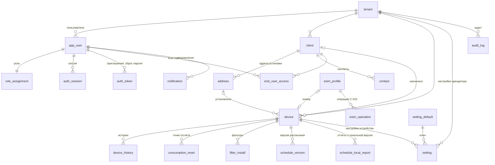

# Схема БД `app`

Бизнес-данные платформы по модели ТЗ Stage 1 §7.2. Ведёт дорожка «Платформа»; исходник — `services/api/src/db/schema.ts`
(Drizzle), права и объекты контракта — `services/api/drizzle/0001_contract.sql`. Кадры, события, агрегаты, команды и
алерты — схема `telemetry` дорожки «Устройство» (§6.3).

Общие правила: у каждой таблицы, кроме справочников, есть `tenant_id`, изоляция — RLS (P-07); ссылки между сущностями
арендатора — составными ключами `(tenant_id, id)`; удаление — логическое (`deleted_at`), время — UTC.

| Таблица | Сущность §7.2 | Что хранит |
|---|---|---|
| `tenant` | Tenant | название, код |
| `app_user` | User | e-mail (уникален без учёта регистра), имя, язык, статус, хеш пароля, счётчик неудачных входов и блокировка (§7.4), последний вход; у SIG Administrator `tenant_id` пуст |
| `role_assignment` | Role assignment | роль раздела 2, одна на пользователя |
| `auth_session`, `auth_token` | — | сессии порталов и одноразовые токены (приглашение 72 ч, сброс пароля) — только хеши |
| `client`, `address`, `contact` | Client, Address, Contact | клиент; адрес с координатами, этажом, местом, комментарием о доступе; контакты |
| `end_user_access` | End User access | привязка End User к клиенту: когда и кто привязал |
| `device` | Device | Device ID IoT Hub, серийник, IMEI, модель (тип воды, исполнение, газированная), ревизия, жизненный цикл, аренда/покупка, клиент и адрес (того же клиента), eSIM, блокировка в IoT Hub |
| `device_history` | Device history | изменения клиента, адреса, статуса, аренды/покупки — только добавление |
| `esim_profile`, `esim_operation` | eSIM profile, eSIM operation | профиль и ручные операции у провайдера с подтверждением |
| `error_code` | Error code | справочник RE-4 (общий) |
| `consumption_reset` | Consumption reset | точка отсчёта: время, кто, `water_total_l` |
| `filter_install` | Filter | установка фильтра: когда, кто, номинал, счётчик в момент установки, команда `filterreset` |
| `schedule_version` | Setting / расписание (§7.3) | версии расписания: номер, пояс, строка `autopowerscheduling`, источник (платформа / на месте), время изменения |
| `schedule_local_report` | — | обработанные отчёты устройства о локальной версии: повтор без новой версии и аудита |
| `setting_default`, `setting` | Setting | значения платформы (§7.4) и переопределения арендатора и устройства |
| `audit_log` | Audit log | кто, что, над чем, до/после, IP — только добавление |
| `notification` | — | лента уведомлений пользователя (V-119) |

Water counter и Telemetry frame, Device event, Command, Alert из §7.2 — в схеме `telemetry`.
